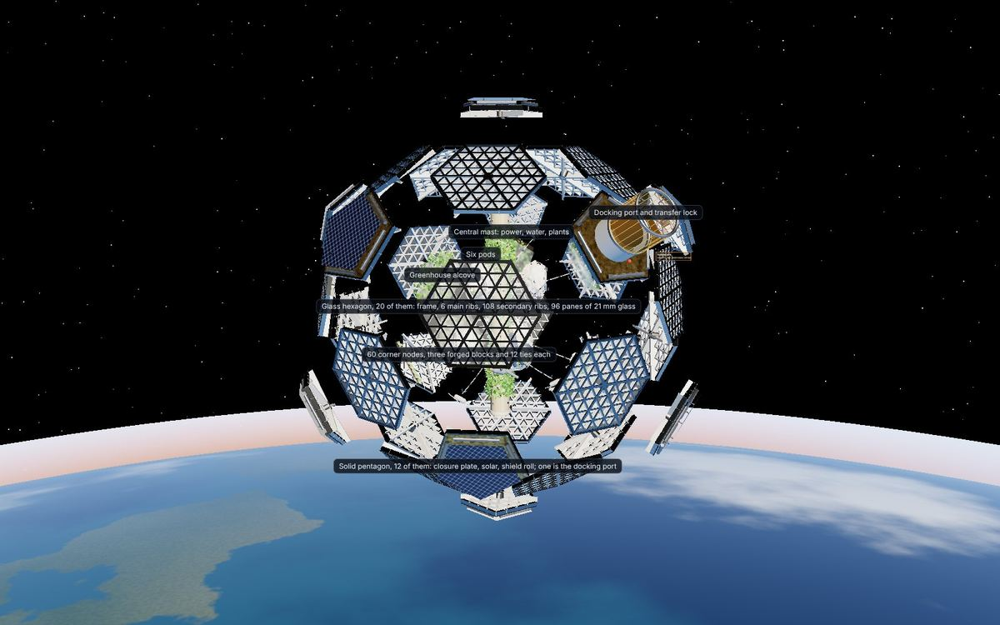
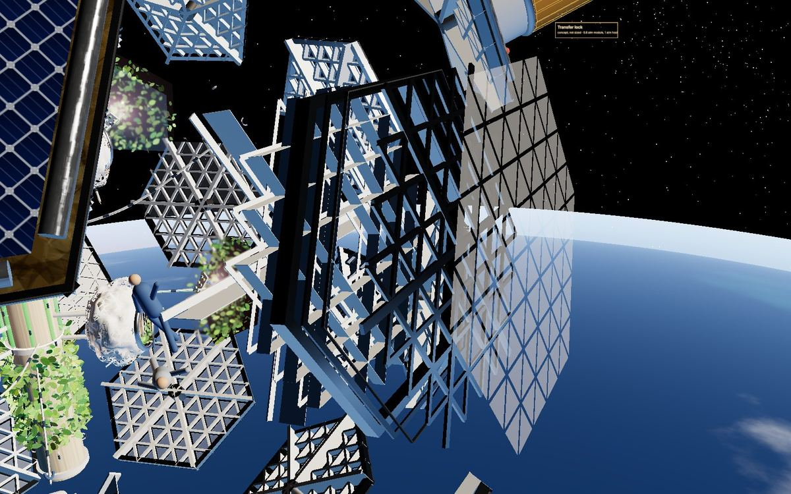
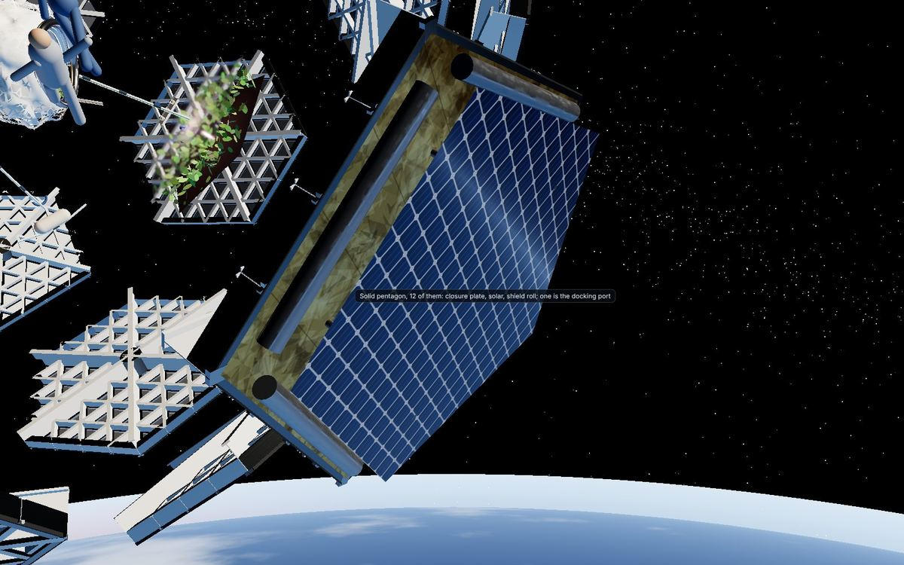
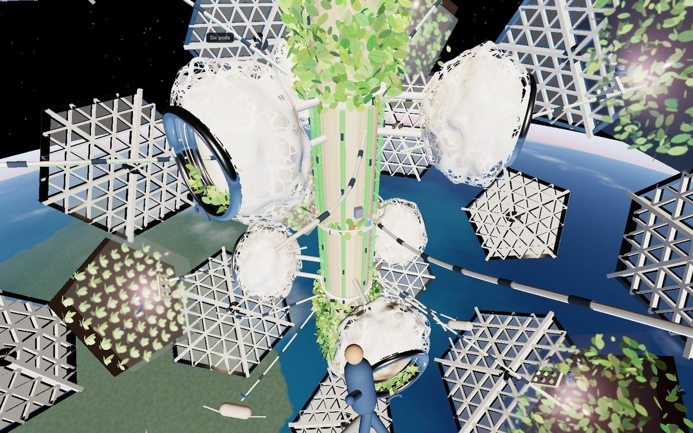
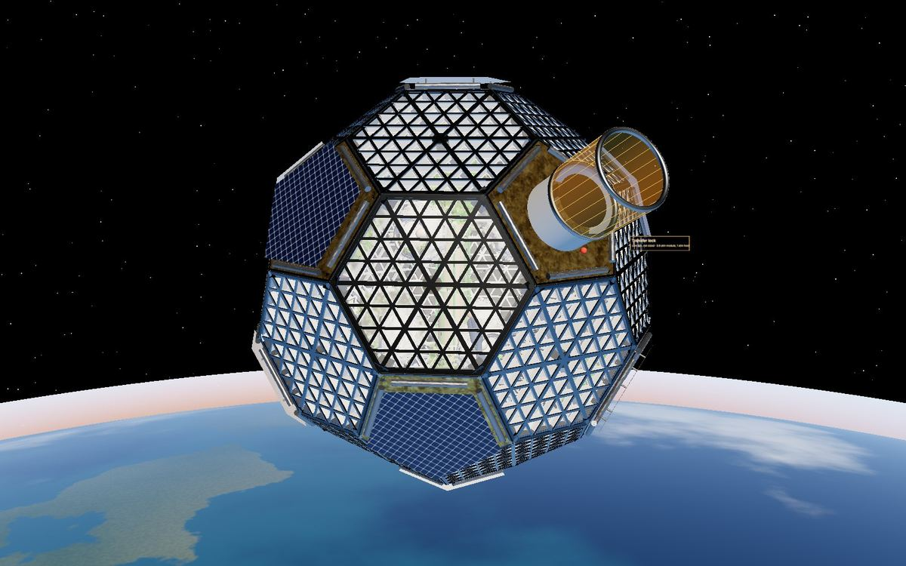

# 1. The facility

## The spec card, Rev F

| Item | Value | Status |
| --- | --- | --- |
| Shape | Truncated icosahedron, 32 flat panels, 20 glass hexagons and 12 solid pentagons, 90 seams, 60 corners | LOCKED |
| Size | 11,151 mm across the corners; every edge 2,250 mm | LOCKED |
| Cabin | 0.8 atm (81 kPa) with 26 percent oxygen; design pressure 12.3 psia with our own relief valve | DECIDED 4 Nov, Rick to sign |
| Host | A module for a 1 atm commercial station, joined through a hatch-shut transfer lock | DECIDED 4 Nov |
| Factors | 1.5 at proof (1.26 atm), 2.0 at ultimate (1.67 atm) | Carried, Rick to confirm |
| Main rib | Option B, I 400 x 100 x 25, web 8, 6 per hexagon and 5 per pentagon, with two bolted cap angles | DECIDED 4 Nov |
| Secondary rib | I 180 x 60 x 10, web 5, custom extrusion, on a k4 grid at 562.5 mm pitch | DECIDED 2 Nov |
| Edge frame | 180 mm deep, 20 mm web, 50 x 10 flanges, seat lip at the cabin face; 6061-T651 for tests, 2219-T851 for flight | DECIDED 5 Nov |
| Pressure pane | 21 mm BOROFLOAT 33, 531 mm panes, 96 per hexagon, 1,920 on the shell, on 2 mm setting strips | DECIDED 5 Nov |
| Seals | Two loops of Parker BA500 butyl, 5.33 mm cord, in 7.1 x 4.0 mm glands at z' 18 and 32; RTV566 bead at z' 42, cured on the ground | DECIDED 5 Nov |
| Seam bolts | NAS6705U27 with KFN670 nut, A286, 4 kN by torque, 16 per seam at 75 mm pitch in bays of 3, 5, 5 and 3, row at z' 58; 1,440 on the shell | DECIDED 5 Nov |
| Corner node | One machined block per panel corner, 60 on the shell, 120 degrees on a hexagon and 108 on a pentagon; four 7/8-14 Inconel 718 ties per face at 198 kN, limit 227 kN | Block PROPOSAL, preload DECIDED 2 Nov |
| Hardpoints | 3 per seam at the quarter points, 270 on the shell; a titanium three-pin fitting, pins 40 mm at 60 mm pitch | PROPOSAL; position open until Tuesday |
| Mass | About 36.1 t for the structure | Model figure |

## The facility taken apart

The team model at hcsa-site.vercel.app/model and the public page at /explore now have a taken-apart view. A slider moves the 32 panels out along their normals, lifts the corner blocks and the hardpoints off the seams, and sets the mast, the six pods and the pentagon kit apart with labels, so every piece in the parts list can be seen on its own and in its place. A second slider takes one hexagon apart into its frames, ribs, panes, blocks and hardpoints. The stills below come from that view.

<figure><figcaption>The facility taken apart: the 32 panels moved out along their normals, the mast, pods and greenhouse alcoves left in place, the docking pentagon with its transfer lock at the top right. From the master model, taken-apart view at 70 percent.</figcaption></figure>

<figure class="half"><figcaption>One hexagon opened into its layers: the frames, the main ribs with their cap angles, the secondary rib grid and the panes, each pulled out along the panel normal.</figcaption></figure><figure class="half"><figcaption>A solar pentagon with its blanket standing off the closure plate and the shield roll along one edge; the greenhouse alcoves show through the hexagons behind.</figcaption></figure>

<figure class="half"><figcaption>Inside, with the panels away: the mast down the middle, the six pods around it and the plant trays.</figcaption></figure><figure class="half"><figcaption>The same model assembled, for comparison.</figcaption></figure>

What the pieces are, from the outside in:

- 20 hexagon panels, each about 1.5 t before its blocks and hardpoints, and 12 pentagon panels. Every hexagon is the same part, and every pentagon is the same part.
- 60 corner blocks, one at every panel corner, tied in threes.
- 270 hardpoint fittings along the seams, three to a seam.
- 1,440 seam bolts, which only clamp the seals.
- The mast down the middle, with the six small pods around it, handrails and perches, and the plant trays.
- The pentagon kit: the closure plate, the solar blankets that stand off the structure, the fold-out shields, the dock and the transfer lock on one pentagon.

Links: the team model is at /model, the public one at /explore, the parts library at /parts and the sheets at /blueprints/#revf, all on hcsa-site.vercel.app. The team pages are behind the site password.
