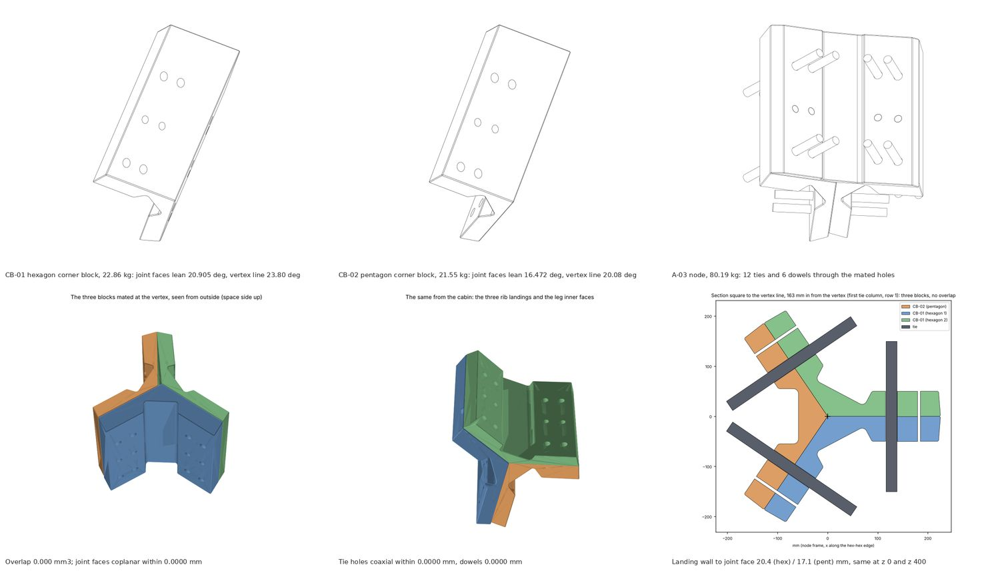

# 2. The flight parts, drawn and in 3D

Nine A3 sheets follow this page. They are drawn from the Rev F parameter file, not traced from CAD, and nobody has checked them for machining yet; that is what the call on 17 November is for. The same parts are in the parts library on the website, each with a STEP file, a GLB for the browser and four drawing views, and the whole facility is in the master model.

## The sheets

| Sheet | What it shows | Status |
| --- | --- | --- |
| RF-01 | The main rib, option B, and the secondary rib, cut through, with the 21 mm panes seated and the glass bite on each. The two new requirements are in the notes: the nodes must hold the main rib sideways, and the panes need an answer for launch | Ribs DECIDED; brace PROPOSAL; pane at launch OPEN |
| RF-02 | A seam cut through at a plain bolt: the 180 mm frame, the two glands, the RTV bead, the bolt at 4 kN, and the study of the seal loop corners against Parker's R16 minimum | Frame, gland, bolt DECIDED; loop corners OPEN |
| RF-03 | The T1 seam slices and the 550 mm article at 180 mm deep. Superseded in detail by the TP sheets in part 3, kept for the record | For reference |
| RF-04 | The transfer lock between the 0.8 atm module and a 1 atm host, as a concept: the hatch that stays shut while the pressures differ, the equalising valves and our relief valve | Concept, not sized. Rick agreed the transfer lock with the 0.8 atm cabin on 10 Nov; the sheet's status line ("Rick to agree") predates that |
| RF-05 | A hexagon-to-hexagon seam cut at the first bolt, 271 mm from the corner, with every feature on the joint face by z', both hardpoint positions as envelopes, and the table that turns z' into panel depth for the hexagon and the pentagon mitres | Seam DECIDED; hardpoint position OPEN; outer glass layers OPEN |
| RF-06 | The hexagon panel from the cabin side: 6 main ribs, 108 secondary rib segments, 96 panes, 18 six-way nodes, 18 hardpoints, the 16 bolts on one edge, and the parts list with masses | Layout DECIDED; blocks, hardpoints and nodes PROPOSAL |
| RF-07 | The hardpoint fitting as the October model has it, at the moved position: what fits (seals, bolts) and what does not (flange, ribs, pin insertion) | PROPOSAL, not yet buildable; position on the line of the pull agreed 10 Nov |
| RF-08 | The corner node in plan and on the joint face, the C1 results, Marco's machining points (inside radii, a landing for the main rib, the material), and the P-11 brace | Block PROPOSAL; ties DECIDED |
| RF-09 | The pentagon panel from the cabin side, with its roles, the closure plate as five triangles, and the solar stand-off | Ribs and frame DECIDED; closure side OPEN (Q57) |

## The parts library

Every part below is at hcsa-site.vercel.app/parts, with STEP, GLB and four views. Masses are from the solids; the solids are weighed as 6061; the flight alloy is open.

| Part | What it is | Each | Per hexagon | Per pentagon |
| --- | --- | --- | --- | --- |
| P-06 | Edge frame member, 180 deep, 2,250 long, with the glands, bolt holes and seat lip | 27.9 kg | 6 | 5 |
| P-04 | Main rib, option B, I 400 x 100 x 25, web 8 | 33.2 kg | 6 | 5 |
| P-04A | Main rib cap angle, one of the two that make the inner flange | 12.8 kg | 12 | 10 |
| P-05 | Hub core, 160 mm, with six forks for the main rib webs; the pentagon needs a five-fork version, not drawn | 28.3 kg | 1 | 1, five forks |
| P-05A | Hub star plate, 25 mm | 14.2 kg | 2 | 2 |
| P-01 | Secondary rib segment, I 180 x 60 x 10, web 5, 562.5 pitch | 2.5 kg | 108 | 90 |
| P-02 | Node star plate | 1.8 kg | 36 | 30 |
| P-03 | Node web core | 4.4 kg | 18 | 15 |
| P-07 | Pressure pane, 21 mm BOROFLOAT 33, 531 mm | 5.5 kg | 96 | none |
| P-08 | Pane corner clamp | 0.2 kg | 18 | none |
| P-09 | One seam bolt station, as an assembly | | 16 per seam | 16 per seam |
| P-14 | Seam bolt NAS6705U27 with KFN670 nut | 0.03 kg | 48 | 40 |
| CB-01 | Corner block, hexagon corner, with the real leaning joint faces; eight tie holes, dowel holes, a landing for the main rib, R10 inside corners | 22.9 kg | 6 | none |
| CB-02 | Corner block, pentagon corner | 21.6 kg | none | 5 |
| P-06H, P-06P | Edge frame member with the web leaning 20.9 degrees (hexagon) or 16.5 (pentagon), 1,790 mm between the blocks; the straight P-06 stays as a schematic | 22.5, 22.1 kg | 6 | 5 |
| HP-02A | Hardpoint lug body, Ti-6Al-4V, from the C3 model: a 39 mm plate, 200 wide, that crosses the joint | 9.7 kg | 9 (half of 18) | half of 15 |
| HP-02B | Hardpoint clevis body, Ti-6Al-4V: two 22.5 mm cheeks | 6.8 kg | 9 | half of 15 |
| HP-03 | Hardpoint pin, 40 x 95, A286, along the panel depth, in double shear | 0.95 kg | 3 per hardpoint | 3 per hardpoint |
| A-05 | The hardpoint assembled at the moved position, with the slot and the two plain bolts beside it | 19.3 kg of fitting | | |
| P-11 | Main rib lateral brace at a node, 7075-T7351, as a pair | 1.1 kg | 18 | 15 |
| PL-01 | Pentagon closure plate, one of five triangles, 10 mm 6061-T651 | 44.9 kg | none | 5 |
| A-01 | The node assembly: star plates, core, rib ends | | 18 | 15 |
| A-02B | The hexagon panel assembly | | 1 | |
| A-03 | The corner node: two hexagon blocks and one pentagon block mated at a real vertex, 12 ties and 6 dowels | 80.2 kg | | |
| A-04 | The pentagon panel assembly, schematic, still with the straight blocks of 8 Nov | 922 kg | | 1 |

P-10 and A-02A, the option A rib and panel, are kept in the library as superseded. The shutters, the outer glass layers and the pentagon equipment are not in the library yet; they are not sized.

## What the solids told us (8 and 9 November)

Building the parts as solids, and then checking them on the real polyhedron, is where most of this week's findings came from. An independent check of the whole package on 9 November found the rest. In order of what matters for the call:

<figure><figcaption>The corner blocks with their leaning joint faces, and two hexagon blocks and one pentagon block mated at a real vertex, from outside and from the cabin. Bottom right: a section through the first tie column, three blocks and no overlap.</figcaption></figure>

1. **The corner node now fits.** On 8 November the blocks were drawn straight and three of them overlapped at a vertex. They are now one outline swept along the vertex line, with each joint face on the radial plane through its edge. Two hexagon blocks and one pentagon block placed at a real vertex share no volume, the joint faces are coplanar, and all 12 tie holes and 6 dowel holes meet on axis. The vertex line leans 23.8 degrees on a hexagon and 20.1 on a pentagon, so the main rib end has to be mitred to land on the block; P-04 is still drawn square.
2. **Tie columns at 130 and 186 mm from the vertex line.** The 87 and 143 mm in the corner model cannot clear the rib landing. On the pentagon block the washer seat is 3.4 mm from the landing edge, which is tight. C1 has to be rerun with the ties here.
3. **The landing leaves 20.4 mm of metal to the joint face on the hexagon block and 17.1 on the pentagon block**, the same at every depth. The R12 we promised at the vertex is taken up by the landing; the inside corners are R10, 430 mm long, and are cut from the open side, not plunged.
4. **The hardpoint position is right and the hardpoint part is not yet a design.** The fitting in the October model is a 39 mm titanium lug on one panel reaching into a two-cheek clevis on the other, with three 40 mm pins along the panel depth in double shear. Our 8 November solids had the pins crossing the joint, which was wrong, and the clash we reported with the seam bolts came from a bolt drawn in the wrong place. With the real part at the moved position, only the lug crosses the joint, through a slot that is 10.5 mm from the RTV recess, 20 mm from the inner gland and clear of the seam bolts. That much works. What does not: the bodies had to move 38 mm apart to sit behind the 20 mm webs, so the lug is longer and the October stiffness no longer applies; the base blocks and pin ends run into the outer flange and into the two secondary ribs that land there; the pins cannot be driven in past the seat lip and the pane; and nothing says how the base blocks fasten to the frame. Sheet RF-07 shows all of it. The fitting has to be redrawn for the 180 mm frame and both models rerun.
5. **The frame is 180 mm deep square to the panel**, like the ribs, so the leaning joint face is 192.7 mm long on a hexagon and 187.7 on a pentagon. Sheet RF-05 is drawn 180 along the face and says so; the features on the face (glands, RTV, bolt row) are placed along it and do not move.
6. **The brace P-11** steps out 12 mm to pass the cap angle's leg; its size has no check behind it.
7. **The closure plate** is cut 10 mm back like the panes; the hub's fork cheeks cross its edge and need a notch. Which side it sits on is still Q57.
8. **Mass does not reconcile yet.** The shell model says 36.1 t. Adding up the parts lists gives about 30.5 t of hexagons with their 10.6 t of glass and about 9.8 t of pentagons, so about 40 t before the corner nodes (60 at 80 kg, 4.8 t, part of which is frame length already counted) and the hardpoint fittings (270 at 19.3 kg, 5.2 t). The solids are weighed at the density of 6061; in 2219 or 7050 the aluminium is 4 to 5 percent heavier. Whether the 36.1 t includes the glass and the fittings has to be traced in the model. Until then the honest figure is 36 to 50 t, and the nodes and the titanium fittings are the two places to look for weight.
9. **Naming.** On sheet RF-01 (5 Nov) P-04A meant the pentagon main rib. Since 8 Nov, P-04 is the main rib on both panels and P-04A is the cap angle.
